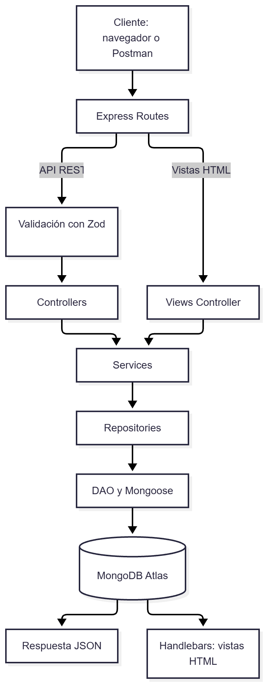
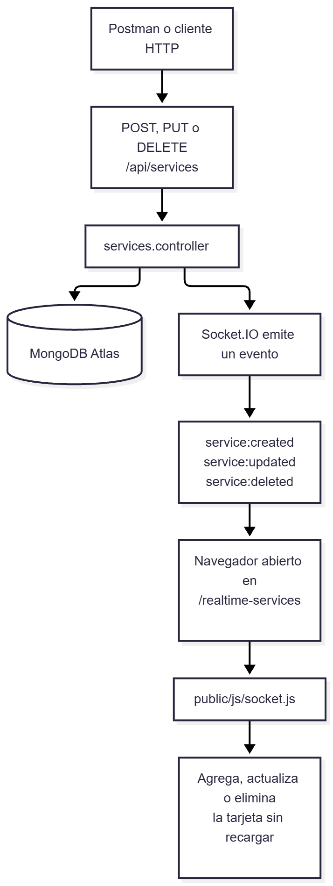

# Sistema de Turnos y Reservas

API REST para gestionar servicios y reservas, desarrollada con Node.js, Express, MongoDB Atlas y Mongoose.

El proyecto mantiene una arquitectura en capas e incorpora vistas renderizadas con Handlebars, actualización en tiempo real con Socket.io, validaciones con Zod, consultas avanzadas de servicios y relaciones entre colecciones mediante `populate()`.

## Tecnologías

- Node.js
- Express
- MongoDB Atlas
- Mongoose
- Zod
- Handlebars
- Socket.io
- dotenv
- JavaScript con módulos ES

## Arquitectura

La aplicación usa una arquitectura en capas:

```text
routes → middlewares → controllers → services → repositories → DAO → models → MongoDB
```

Responsabilidad de cada capa:

- **Routes:** define los endpoints y los conecta con middlewares y controllers.
- **Middlewares:** valida los datos de entrada antes de que lleguen a los controllers.
- **Controllers:** recibe la petición, usa los services y construye la respuesta HTTP o la vista.
- **Services:** contiene reglas de negocio.
- **Repositories:** conecta los services con los DAO.
- **DAO:** accede a MongoDB mediante Mongoose.
- **Models:** define los schemas de las colecciones.
- **Validations:** contiene los esquemas de validación con Zod.

## Diagramas

### Flujo general de la aplicación



### Flujo de actualizaciones en tiempo real




## Estructura del proyecto

```text
src/
├── config/
│   ├── database.config.js
│   └── env.config.js
├── controllers/
│   ├── bookings.controller.js
│   ├── services.controller.js
│   └── views.controller.js
├── dao/
│   ├── models/
│   │   ├── booking.model.js
│   │   ├── message.model.js
│   │   └── service.model.js
│   ├── bookings.dao.js
│   └── services.dao.js
├── middlewares/
│   ├── error.middleware.js
│   └── validate.middleware.js
├── repositories/
│   ├── bookings.repository.js
│   └── services.repository.js
├── routes/
│   ├── bookings.router.js
│   ├── services.router.js
│   └── views.router.js
├── services/
│   ├── bookings.service.js
│   └── services.service.js
├── validations/
│   ├── booking.validation.js
│   └── service.validation.js
├── views/
│   ├── layouts/
│   │   └── main.handlebars
│   ├── availability.handlebars
│   ├── booking-detail.handlebars
│   ├── error.handlebars
│   ├── service-detail.handlebars
│   └── services.handlebars
├── app.js
└── server.js

public/
├── css/
│   └── styles.css
└── js/
    └── socket.js
```

## Instalación

Clona el repositorio:

```bash
git clone https://github.com/elilopcon2-sys/sistema-turnos.git
cd sistema-turnos
```

Instala las dependencias:

```bash
npm install
```

## Variables de entorno

Copia el archivo de ejemplo para crear tu configuración local:

```bash
cp .env.example .env

```env
PORT=8080
NODE_ENV=development
MONGO_URI=TU_URI_DE_MONGODB_ATLAS
```

> No subas el archivo `.env` ni la carpeta `node_modules` al repositorio.

## Ejecución

```bash
npm start
```

El servidor se ejecuta en:

```text
http://localhost:8080
```
## Funcionalidades principales

- Gestión completa de servicios: creación, consulta, actualización y eliminación.
- Filtros, paginación y ordenamiento de servicios.
- Gestión de reservas y asociación de servicios.
- Actualización de cantidades y eliminación de servicios dentro de una reserva.
- Eliminación completa de reservas.
- Relaciones entre reservas y servicios mediante referencias de MongoDB y `populate()`.
- Vistas dinámicas con Handlebars.
- Actualizaciones en tiempo real con Socket.IO.
- Validaciones de datos con Zod.
- Manejo controlado de errores para API y vistas.

## API REST

La API continúa funcionando de forma independiente de las vistas.

## Servicios

| Método | Ruta | Descripción |
|---|---|---|
| GET | `/api/services` | Obtiene servicios con filtros, paginación y ordenamiento. |
| GET | `/api/services/:sid` | Obtiene un servicio por ID. |
| POST | `/api/services` | Crea un servicio. |
| PUT | `/api/services/:sid` | Actualiza un servicio. |
| DELETE | `/api/services/:sid` | Elimina un servicio. |

### Consultas avanzadas de servicios

El endpoint:

```http
GET /api/services
```

acepta los siguientes query params:

- `category`
- `available`
- `page`
- `limit`
- `sortBy`
- `order`

### Filtrar por categoría

```http
GET /api/services?category=Belleza
```

### Filtrar por disponibilidad

```http
GET /api/services?available=true
```

### Combinar filtros

```http
GET /api/services?category=Belleza&available=true
```

### Paginación

```http
GET /api/services?page=2&limit=5
```

La respuesta incluye metadatos de paginación:

```json
{
  "services": [],
  "pagination": {
    "total": 12,
    "page": 2,
    "limit": 5,
    "totalPages": 3,
    "hasPrevPage": true,
    "hasNextPage": true
  }
}
```

### Ordenamiento

Ordenar por precio ascendente:

```http
GET /api/services?sortBy=price&order=asc
```

Ordenar por precio descendente:

```http
GET /api/services?sortBy=price&order=desc
```

Los campos permitidos para ordenar son:

- `id`
- `name`
- `duration`
- `price`
- `category`
- `available`

### Consulta combinada

```http
GET /api/services?category=Belleza&available=true&page=1&limit=5&sortBy=price&order=asc
```

### Ejemplo para crear un servicio

```json
{
  "name": "Manicure",
  "description": "Servicio de manicure tradicional",
  "duration": 45,
  "price": 40000,
  "category": "Belleza",
  "available": true
}
```

## Validaciones con Zod

La API utiliza Zod como capa de validación antes de que los datos lleguen al controller y a MongoDB.

Se aplican validaciones en:

- creación de servicios
- actualización de servicios
- creación de reservas
- agregado de servicios a una reserva

Las validaciones se encuentran en:

```text
src/validations/
```

y se ejecutan mediante:

```text
src/middlewares/validate.middleware.js
```

Flujo de validación:

```text
Request
  ↓
Middleware de validación con Zod
  ↓
Controller
  ↓
Service
  ↓
Repository
  ↓
DAO
  ↓
MongoDB
```

Si los datos son inválidos, el flujo se corta antes de llegar al controller y la API responde con:

```http
400 Bad Request
```

Ejemplo:

```json
{
  "status": "error",
  "message": "Datos inválidos",
  "errors": [
    {
      "field": "body.price",
      "message": "El precio no puede ser negativo"
    }
  ]
}
```

## Reservas

| Método | Ruta | Descripción |
|---|---|---|
| GET | `/api/bookings` | Obtiene todas las reservas con sus servicios asociados. |
| POST | `/api/bookings` | Crea una reserva vacía. |
| GET | `/api/bookings/:bid` | Obtiene una reserva por ID con `populate()`. |
| POST | `/api/bookings/:bid/services/:sid` | Agrega un servicio a una reserva o incrementa su cantidad. |
| PUT | `/api/bookings/:bid/services/:sid` | Actualiza la cantidad de un servicio asociado. |
| DELETE | `/api/bookings/:bid/services/:sid` | Quita un servicio de una reserva. |
| DELETE | `/api/bookings/:bid` | Elimina una reserva completa. |

### Ejemplo para crear una reserva

```json
{
  "clientName": "Cliente de prueba",
  "clientEmail": "cliente@example.com",
  "date": "2026-10-05",
  "time": "10:00",
  "status": "pending"
}
```

## Relación entre reservas y servicios

Las reservas no guardan el objeto completo del servicio.

Cada servicio asociado se almacena como una referencia a la colección `services`, junto con la cantidad:

```json
{
  "service": "ObjectId",
  "quantity": 2
}
```

En el modelo de reservas, `service` se define como un `ObjectId` de Mongoose con referencia al modelo `Service`.

Esto permite mantener una relación entre ambas colecciones sin duplicar la información del servicio dentro de la reserva.

## Consulta de reservas con populate

Para consultar una reserva junto con la información completa de los servicios asociados se utiliza:

```http
GET /api/bookings/:bid
```

Este endpoint utiliza `populate()` de Mongoose.

Ejemplo de respuesta:

```json
{
  "id": 1,
  "clientName": "Cliente de prueba",
  "clientEmail": "cliente@example.com",
  "date": "2026-10-05",
  "time": "10:00",
  "status": "pending",
  "services": [
    {
      "service": {
        "id": 2,
        "name": "Manicure",
        "description": "Servicio de manicure tradicional",
        "duration": 45,
        "price": 40000,
        "category": "Belleza",
        "available": true
      },
      "quantity": 2
    }
  ]
}
```

`populate()` se utiliza únicamente al consultar la reserva.

En MongoDB se mantiene almacenada la referencia `ObjectId`, no el objeto completo del servicio.

## Vistas con Handlebars

Handlebars permite renderizar HTML desde Express usando datos reales de MongoDB.

| Método | Ruta | Descripción |
|---|---|---|
| GET | `/services` | Muestra todos los servicios. |
| GET | `/services/:sid` | Muestra el detalle de un servicio. |
| GET | `/realtime-services` | Muestra los servicios disponibles y recibe actualizaciones en tiempo real. |
| GET | `/bookings/:bid` | Muestra una reserva con sus servicios asociados completos. |

Las vistas usan la misma arquitectura del proyecto:

```text
views.router → views.controller → services.service → repository → DAO → MongoDB
```

No hay servicios escritos manualmente en los archivos `.handlebars`: la información siempre proviene de la base de datos.

## Tiempo real con Socket.IO

La vista `/realtime-services` utiliza Socket.IO para reflejar cambios sin recargar el navegador.

| Evento | Cuándo se emite | Comportamiento en la vista |
|---|---|---|
| `service:created` | Se crea un servicio. | Agrega una tarjeta si el servicio está disponible. |
| `service:updated` | Se actualiza un servicio. | Actualiza, agrega o elimina la tarjeta según su disponibilidad. |
| `service:deleted` | Se elimina un servicio. | Quita la tarjeta correspondiente. |

Flujo:

```text
Postman o cliente HTTP
        ↓
API REST modifica MongoDB
        ↓
Controller emite evento Socket.IO
        ↓
/realtime-services recibe el evento
        ↓
La vista se actualiza sin recargar

## Manejo de errores

La API valida los datos de entrada con Zod y devuelve respuestas claras según el caso.

| Situación | Código | Respuesta |
|---|---:|---|
| Datos inválidos o incompletos | `400` | JSON con el detalle de validación. |
| Recurso inexistente | `404` | JSON con un mensaje descriptivo. |
| Ruta de API inexistente | `404` | JSON con el mensaje `La ruta solicitada no existe.` |
| Vista inexistente o recurso no encontrado | `404` | Página HTML amigable con enlace para volver a servicios. |
| Error inesperado | `500` | Respuesta controlada sin exponer detalles técnicos. |

## Persistencia

MongoDB almacena las colecciones:

- `services`
- `bookings`
- `messages`

Cada servicio contiene:

```text
id, name, description, duration, price, category, available
```

Cada reserva contiene:

```text
id, clientName, clientEmail, date, time, status, services
```

Las reservas guardan los servicios asociados mediante referencias de MongoDB.

Cada elemento del arreglo `services` contiene:

```text
service: ObjectId
quantity: Number
```
## Pruebas manuales

Se realizaron pruebas manuales con Postman o Thunder Client sobre los siguientes endpoints y comportamientos:

### Servicios

- `GET /api/services`
- `GET /api/services/:sid`
- `POST /api/services`
- `PUT /api/services/:sid`
- `DELETE /api/services/:sid`
- Filtros, paginación y ordenamiento mediante query params.

### Reservas

- `GET /api/bookings`
- `POST /api/bookings`
- `GET /api/bookings/:bid`
- `POST /api/bookings/:bid/services/:sid`
- `PUT /api/bookings/:bid/services/:sid`
- `DELETE /api/bookings/:bid/services/:sid`
- `DELETE /api/bookings/:bid`
- Consulta de una reserva con servicios completos mediante `populate()`.

### Casos de error

- Consultar un servicio o reserva inexistente.
- Crear un servicio con datos incompletos.
- Enviar una cantidad inválida, como `0` o un texto.
- Agregar a una reserva un servicio inexistente.
- Consultar rutas web y de API inexistentes.

### Vistas y tiempo real

- Abrir `/services`, `/realtime-services` y `/bookings/:bid`.
- Crear un servicio disponible y verificar que aparezca sin recargar.
- Cambiar disponibilidad y verificar que desaparezca o reaparezca.
- Eliminar un servicio y verificar que desaparezca sin recargar.

## Seguridad

El proyecto incluye `.env.example` como referencia de configuración.

Nunca se deben publicar:

```text
.env
node_modules
credenciales reales de MongoDB Atlas
```

## Autora

Elizabeth Lopez Conde